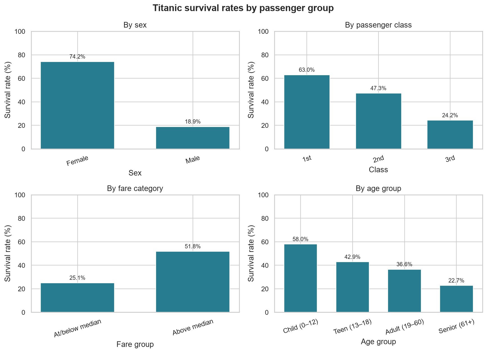
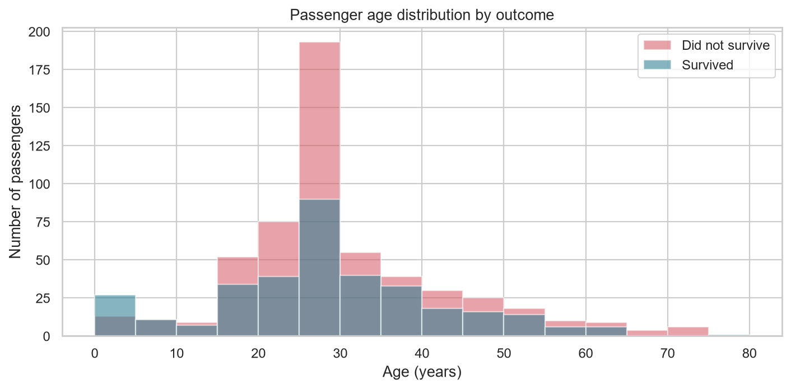
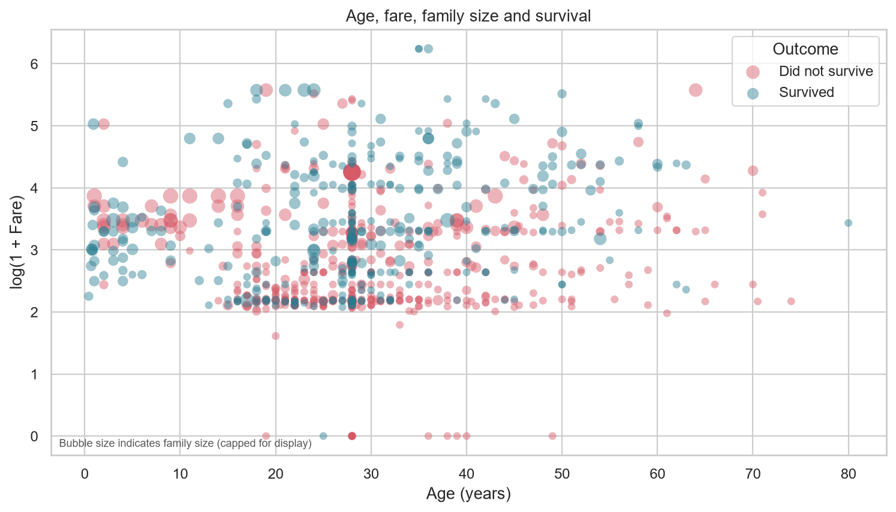
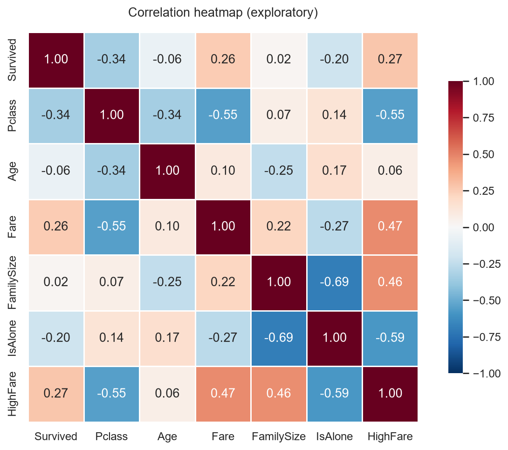

# Titanic Survival Analysis — Exploratory Data Analysis

A Python portfolio project exploring passenger survival patterns in the Titanic dataset. This project builds on an introductory university Pandas exercise and extends it with charts, a correlation heatmap, a multidimensional bubble plot, and documented limitations.

## At a glance

| Metric | Result |
|---|---:|
| Passenger records | 891 |
| Overall survival rate | 38.38% |
| Survival rate — female | 74.20% |
| Survival rate — male | 18.89% |
| First-class survival rate | 62.96% |
| Third-class survival rate | 24.24% |
| Survival rate — above median fare | 51.80% |
| Survival rate — at/below median fare | 25.06% |

## Visualizations

**Survival rates by passenger group**  


**Age distribution by outcome**  


**Multidimensional bubble chart: age, fare, family size, survival**  


**Exploratory correlation heatmap**  


## Data cleaning & feature engineering

- `Age`: 177 missing values, replaced with the median age of 28.
- `Embarked`: 2 missing values, filled using the mode `S`.
- `Cabin`: dropped because 687 out of 891 values (77.10%) were missing.
- Created `FamilySize`, `IsAlone`, `HighFare`, and `AgeGroup`.
- Kept all 891 passenger rows, validated unique passenger IDs, and confirmed no missing cells in the cleaned data.

## How to run

1. Clone or download the repository.
2. Install dependencies (preferably inside a virtual environment):

   ```bash
   pip install -r requirements.txt
   ```

3. Open `notebooks/titanic_survival_analysis.ipynb` in Jupyter or VS Code, then run all cells. Start Jupyter from the repository root, or open the notebook directly; both locations are supported.
4. The notebook writes charts to `figures/` and cleaned data to `data/titanic_cleaned.csv`.

## Project structure

```text
titanic-survival-analysis/
├── data/
│   ├── titanic.csv
│   └── titanic_cleaned.csv
├── figures/
│   ├── survival_by_group.png
│   ├── age_distribution.png
│   ├── age_fare_bubble.png
│   └── correlation_heatmap.png
├── notebooks/
│   └── titanic_survival_analysis.ipynb
├── requirements.txt
└── README.md
```

## Limitations

The results describe **associations** in a historical sample, not causal effects. Imputing missing ages with the median affects age-based comparisons. Fare and ticket class are related, so simple group comparisons cannot isolate the influence of individual variables. This is exploratory analysis, not a predictive model.

## Dataset credit

Titanic training data, originally popularized by the [Kaggle Titanic competition](https://www.kaggle.com/competitions/titanic/data), supplied as `titanic.csv` for a university practical lab. The original raw dataset is retained under `data/`, with an independently generated cleaned copy.

## Tech stack

Python · Pandas · NumPy · Matplotlib · Seaborn · Jupyter Notebook
